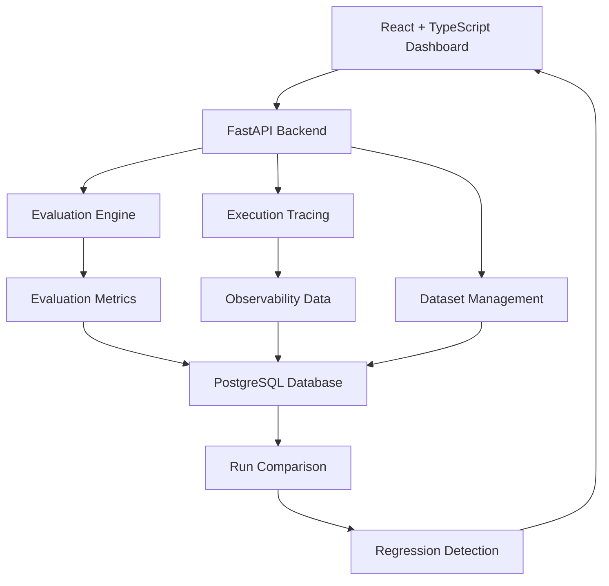

# ReliAI — AI Evaluation & Reliability Platform

**Evaluate AI. Monitor execution. Detect regressions. Improve reliability.**

ReliAI is an AI evaluation and observability platform designed to assess the quality, performance, and reliability of AI-powered applications. It enables developers to manage evaluation datasets, execute evaluation runs, inspect execution traces, compare results, and identify performance regressions.

The platform provides a structured approach to understanding how AI applications behave across different evaluation runs, making it easier to identify failures and track improvements over time.

---

## Key Features

### 1. Evaluation Management
- Create and manage evaluation datasets.
- Execute evaluation runs against stored datasets.
- Persist evaluation results for historical analysis.
- Track individual test-case outcomes and failures.

### 2. Evaluation Metrics
- Exact-match evaluation.
- JSON validity checking.
- Keyword-based evaluation.
- Case-level success and failure tracking.
- Aggregated evaluation metrics.

### 3. Execution Observability
- Capture execution traces for evaluation runs.
- Track request latency.
- Record provider and model information.
- Monitor token usage.
- Capture sanitized error categories for failure analysis.

### 4. Run Comparison
- Compare compatible evaluation runs.
- Analyze changes in evaluation metrics.
- Identify improvements and performance degradation.
- Track reliability trends across executions.

### 5. Regression Detection
- Configure threshold-based regression checks.
- Detect metric degradation between evaluation runs.
- Identify potential quality and performance issues.

### 6. Data Import & Integration
- Bulk dataset import through CSV, JSON, JSONL, and NDJSON formats.
- HTTP-based evaluation of external AI applications.
- REST API integration for evaluation workflows.

---

## System Architecture



### Architecture Components

| Component | Responsibility |
|---|---|
| Frontend | Evaluation dashboard and result visualization |
| FastAPI | REST API and application logic |
| Evaluation Engine | Executes evaluation logic and calculates metrics |
| Dataset Manager | Stores and manages evaluation datasets |
| Trace Manager | Captures execution and performance information |
| PostgreSQL | Persistent storage for datasets, runs, and traces |
| Regression Engine | Identifies metric degradation using configured thresholds |

---

## Technology Stack

| Category | Technologies |
|---|---|
| Backend | Python, FastAPI |
| Frontend | React, TypeScript |
| Database | PostgreSQL |
| ORM & Migrations | SQLAlchemy, Alembic |
| Validation | Pydantic |
| Testing | Pytest |
| Containerization | Docker, Docker Compose |
| Integration | REST APIs |

---

## Testing & Validation

ReliAI includes automated backend tests covering its core application functionality.

Previously recorded verification:
- **86 backend tests** passed.
- Evaluation and dataset management workflows tested.
- Execution traces and run comparison validated.
- Dataset import and HTTP evaluation functionality tested.
- Frontend production build completed.

*Test counts represent the previously recorded verification run and should be updated when new tests are added.*

---

## Project Structure

The project is organized around the frontend, backend services, database migrations, and automated tests.

```text
ReliAI/
├── frontend/
│   └── React + TypeScript application
├── backend/
│   └── FastAPI application
├── migrations/
│   └── Database schema migrations
├── tests/
│   └── Automated backend tests
├── docker-compose.yml
├── .env.example
└── README.md
```

*Adjust this tree to match the actual repository structure before publishing.*

---

## Getting Started

### Prerequisites

- Python 3.10+
- Node.js and npm
- PostgreSQL
- Docker and Docker Compose

### 1. Clone the Repository

```bash
git clone <YOUR_REPOSITORY_URL>
cd ReliAI
```

### 2. Configure Environment Variables

Create your environment file using the provided example:

```bash
cp .env.example .env
```

Configure the required database connection and application settings in `.env`.

### 3. Start the Backend

Create and activate a virtual environment:

```bash
python -m venv venv
```

Install dependencies:

```bash
pip install -r requirements.txt
```

Start the FastAPI application using the project's configured entry point.

### 4. Start the Frontend

```bash
cd frontend
npm install
npm run dev
```

### 5. Run Tests

```bash
pytest -q
```

*Refer to the actual backend and frontend configuration files for the exact startup commands and environment variable names.*

---

## Engineering Highlights

- Designed a persistent evaluation workflow instead of relying on temporary evaluation results.
- Separated evaluation logic from application and API layers.
- Implemented execution-level observability for analyzing AI application behavior.
- Added run comparison and threshold-based regression detection.
- Supported multiple dataset formats and external HTTP evaluation.
- Used automated testing to validate backend functionality.

---

## Project Objective

ReliAI explores an important aspect of production AI engineering: building AI applications is not enough; their outputs, execution behavior, and reliability must also be measured and monitored.

The goal is to provide a reusable evaluation and observability foundation that helps developers understand AI application quality and detect regressions as systems evolve.

---

**Project:** ReliAI — AI Evaluation & Reliability Platform  
**Category:** AI Engineering | Evaluation | Observability | Reliability Engineering
